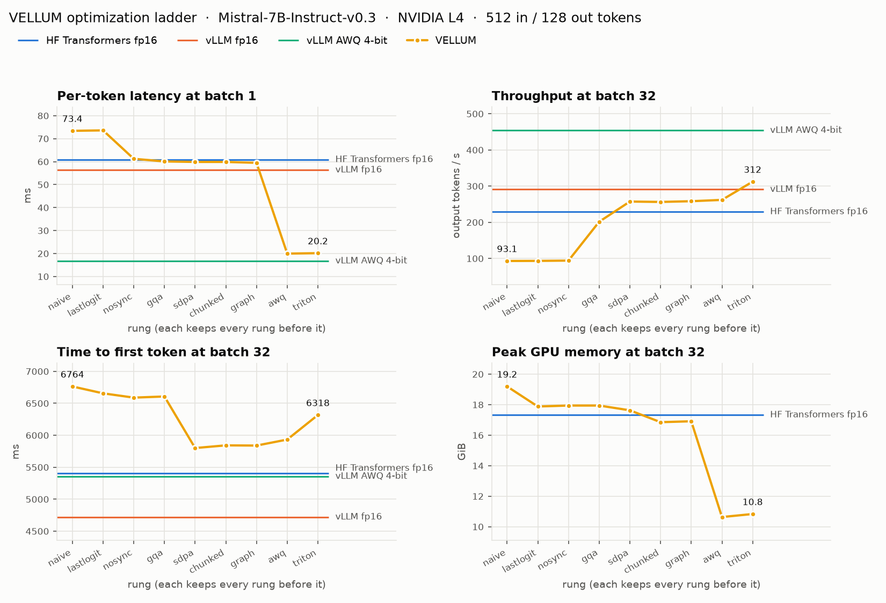
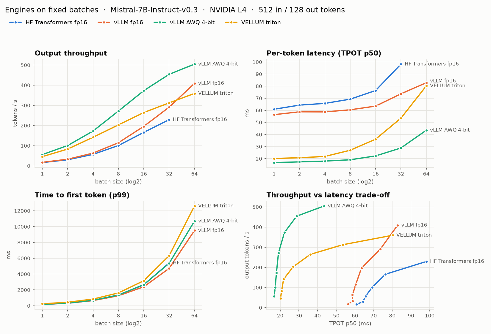
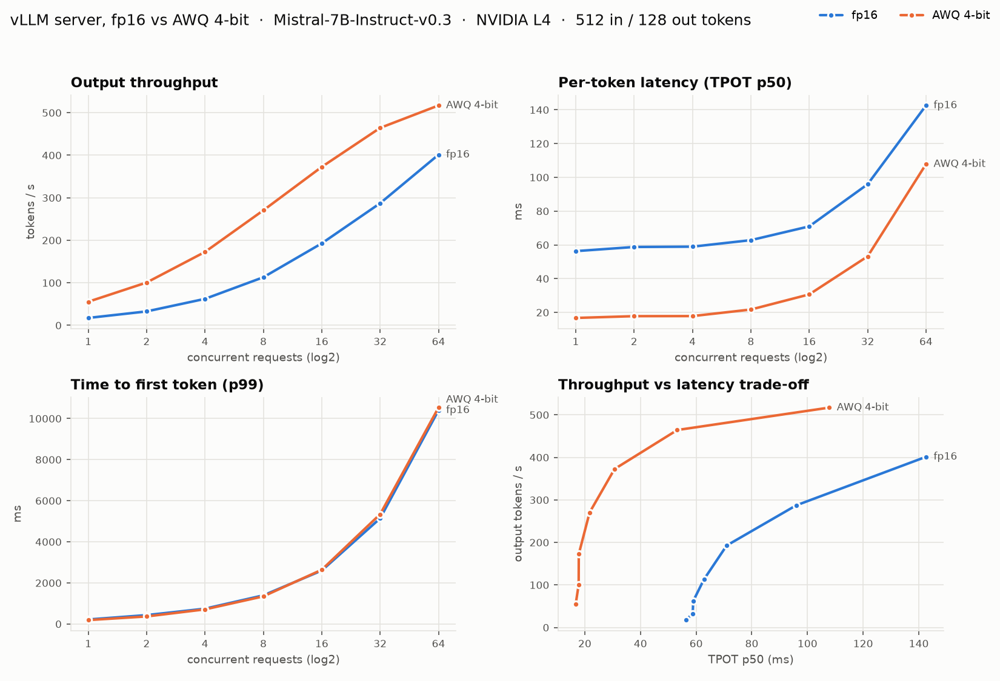
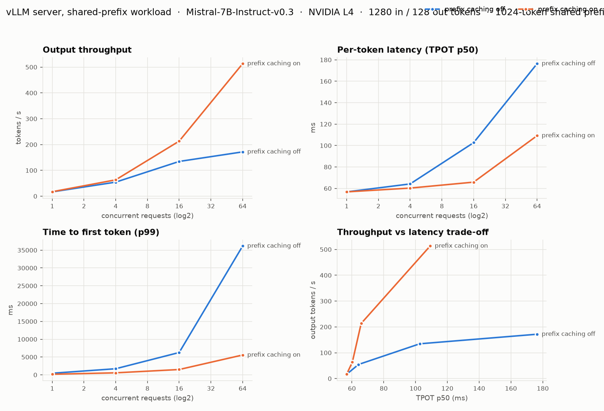
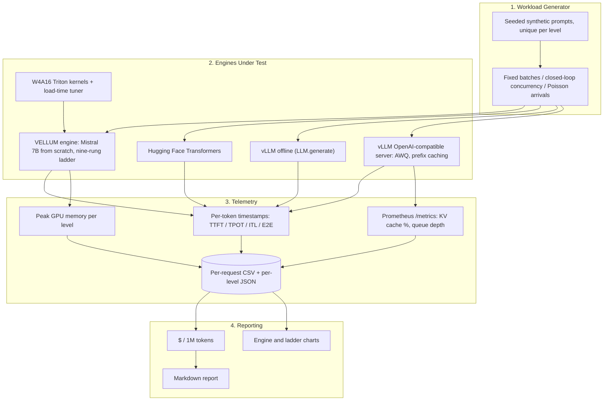

# VELLUM: A Silicon-to-Serving Systems Study in LLM Inference

VELLUM builds Mistral 7B inference from scratch in plain PyTorch, then optimizes it one measured change at a time on an NVIDIA L4, ending in its own Triton GPU kernels. Every step is benchmarked against Hugging Face Transformers and vLLM running the same weights.

Educational reimplementations show a model's math but none of the systems problems that dominate real inference: host syncs, memory ceilings, kernel-launch overhead, memory bandwidth. Production engines solve those problems across hundreds of thousands of lines, where cause and effect are hard to see. VELLUM sits between the two. The code stays small enough to read, and each optimization is a separate rung of a ladder, so every gain traces to one change and one physical cause.

| Layer | In VELLUM |
|---|---|
| Model | Mistral 7B v0.3 built section by section on the real weights: tokenizer, rotary embeddings, grouped-query attention, KV cache, sliding window, RMSNorm, SwiGLU |
| Ladder | Nine rungs, from the model exactly as built to 4-bit weights on custom kernels, each adding one change |
| Kernels | W4A16 Triton kernels that dequantize 4-bit AWQ weights in registers, picked per layer shape and batch size at load |
| Serving | An async load harness: fixed batches, closed-loop concurrency or Poisson arrivals, with TTFT / TPOT / ITL percentiles, peak memory and vLLM's KV-cache telemetry |
| Cost | Dollars per 1M output tokens at the measured rate |

One command reproduces every number on a Google Cloud L4, in about 2.5 hours of GPU time (roughly $2 at the on-demand price):

```bash
bash scripts/gcp_run.sh
```



---

## Results: Mistral 7B v0.3 on one NVIDIA L4

One 24 GB NVIDIA L4 (a GCP `g2-standard-8`), driver 580, vLLM 0.31.0, PyTorch 2.13, Transformers 5.17, Triton 3.7. Offline runs use 512-token prompts and 128 greedy output tokens with EOS ignored, median of 3 repeats. Cost per 1M output tokens uses the `g2-standard-8` on-demand price, $0.85/hr, at full utilization.

Every number comes from [`results/NVIDIA-L4/`](results/NVIDIA-L4/): [`report.md`](results/NVIDIA-L4/report.md) for speed, memory and cost, [`awq_quality.json`](results/NVIDIA-L4/awq_quality.json) for perplexity, [`int4_kernels.json`](results/NVIDIA-L4/int4_kernels.json) for kernel timings. The 4-bit rungs were measured after the main run, on the same GPU type, driver and software. In those later sessions, re-runs of the `graph` and `awq` rungs reproduced their published numbers within 1% ([`awq-kernels/`](results/NVIDIA-L4/awq-kernels/)). [`env.txt`](results/NVIDIA-L4/env.txt) records every run.

### VELLUM against HF Transformers and vLLM

| Engine | Per-token latency, batch 1 | Throughput, batch 32 | Throughput, batch 64 | Peak GPU memory, batch 32 | $ / 1M tokens, batch 32 |
|---|---:|---:|---:|---:|---:|
| HF Transformers, fp16 | 60.9 ms | 229 tok/s | out of memory | 17.3 GiB | $1.03 |
| vLLM, fp16 | 56.4 ms | 291 tok/s | 409 tok/s | – | $0.81 |
| **VELLUM, fp16** (`graph` rung) | **59.5 ms** | **258 tok/s** | **348 tok/s** | **16.9 GiB** | **$0.91** |
| vLLM, AWQ 4-bit | 16.8 ms | 454 tok/s | 505 tok/s | – | $0.52 |
| **VELLUM, AWQ 4-bit** (`awq` rung) | **20.0 ms** | **262 tok/s** | **282 tok/s** | **10.6 GiB** | **$0.90** |
| **VELLUM, AWQ 4-bit + Triton** (`triton` rung) | **20.2 ms** | **312 tok/s** | **359 tok/s** | **10.8 GiB** | **$0.76** |

vLLM reserves its GPU memory up front, so it has no peak-memory figure.



### What each rung bought

| Rung | Change (each keeps every rung before it) | Per-token latency, batch 1 | Throughput, batch 32 | Throughput, batch 64 | Peak memory, batch 32 |
|---|---|---:|---:|---:|---:|
| `naive` | The model exactly as the build notebook writes it | 73.4 ms | 93 tok/s | out of memory | 19.2 GiB |
| `lastlogit` | Prefill projects only the last position onto the 32,768-token vocab | 73.6 ms | 93 tok/s | out of memory | **17.9 GiB** |
| `nosync` | The decode position stays a Python int: no `.item()` host sync per layer | **61.2 ms** | 94 tok/s | out of memory | 17.9 GiB |
| `gqa` | The 4 query heads sharing a KV head read it in place, instead of `repeat_kv` copying the cache 4× | 60.1 ms | **202 tok/s** | out of memory | 17.9 GiB |
| `sdpa` | Fused `scaled_dot_product_attention` (FlashAttention on prefill) | 59.9 ms | **257 tok/s** | out of memory | 17.6 GiB |
| `chunked` | Prefill in chunks of at most 8,192 tokens across the batch, attending to the cache | 59.9 ms | 256 tok/s | **346 tok/s** | 16.9 GiB |
| `graph` | The decode step is captured once as a CUDA graph and replayed | 59.5 ms | 258 tok/s | 348 tok/s | 16.9 GiB |
| `awq` | 4-bit AWQ weights on PyTorch's int4 kernel, rebuilt to a dense weight for prefill | **20.0 ms** | 262 tok/s | 282 tok/s | **10.6 GiB** |
| `triton` | VELLUM's Triton kernels, wherever they measure faster | 20.2 ms | **312 tok/s** | **359 tok/s** | 10.8 GiB |

### Rung 9: the Triton kernels

[`vellum/mistral/w4a16.py`](vellum/mistral/w4a16.py) holds three Triton kernels that multiply by AWQ's 4-bit codes directly. They dequantize in registers, so every byte read from memory is two weights.

* `gemv` runs on CUDA cores with one to eight input rows per program. It is built for decode, where a matmul is mostly a stream of weights.
* `gemm_t` puts tensor cores on yᵀ = W·xᵀ: the weight tile is the large operand and the few input rows, padded to 16, the small one.
* `gemm` is a tiled tensor-core GEMM for larger inputs.

At load, [`awq.tune()`](vellum/mistral/awq.py) times every path for each of Mistral's four layer shapes from 1 to 8,192 rows: these kernels at 16 tile configurations, PyTorch's int4 kernel, and the dense rebuild. It checks each winner against the dequantized weight, and every layer then follows the fastest path for its row count. On the L4 the tuner keeps PyTorch's kernel up to 8 rows, uses the Triton kernels from 9 rows up to 128–512 depending on the layer, and rebuilds the dense weight for prefill. The small `wk` and `wv` projections go straight from PyTorch's kernel (to 16 rows) to the dense rebuild.

Time spent in the 224 4-bit matmuls of one decode step, each weight streamed from memory ([`scripts/bench_int4.py`](scripts/bench_int4.py)):

| Batch | bf16 (cuBLAS) | PyTorch int4 | VELLUM Triton |
|---:|---:|---:|---:|
| 1 | 54.3 ms | **14.5 ms** | 16.7 ms |
| 8 | 56.4 ms | **15.6 ms** | 22.3 ms |
| 16 | 57.0 ms | 30.4 ms | **21.5 ms** |
| 32 | 61.3 ms | 59.3 ms | **29.7 ms** |
| 64 | 62.6 ms | 114.0 ms | **38.9 ms** |

PyTorch's kernel is the fastest for a handful of rows but slows linearly past eight. The Triton kernels stay near the bandwidth floor much longer. End to end:

| | Batch 1 | Batch 8 | Batch 16 | Batch 32 | Batch 64 |
|---|---:|---:|---:|---:|---:|
| `awq` rung, per-token latency | 20.0 ms | 25.2 ms | 44.2 ms | 76.4 ms | 135.8 ms |
| `triton` rung, per-token latency | 20.2 ms | 27.0 ms | **36.1 ms** | **53.5 ms** | **80.2 ms** |
| `awq` rung, throughput | 46.1 tok/s | 217.3 tok/s | 240.4 tok/s | 261.9 tok/s | 281.7 tok/s |
| `triton` rung, throughput | 45.7 tok/s | 203.1 tok/s | **264.4 tok/s** | **312.4 tok/s** | **359.3 tok/s** |

Through batch 8, `triton` decodes on exactly `awq`'s kernels, and from batch 2 up its prefill runs the same dense path. The 1–7% it gives up there (batch-8 decode 27.0 vs 25.2 ms, batch-8 prefill 1,615 vs 1,510 ms) is the L4 it ran on, a later session's GPU, not the code. From batch 16 up, the Triton kernels cut per-token latency by 18–41%.

PyTorch's kernel reads its own tiled copy of the codes, 3.3 GiB on Mistral 7B. Where memory matters more than small-batch speed, `vellum offline --rung triton --awq-single-copy` (or `load_model(..., int4pack=False)`) never builds that copy. Right after load the model then takes 4.17 GiB instead of 7.44, and the peak during load and tuning drops from 7.44 to 4.92 GiB, so a smaller GPU can start it at all. The cost is small-batch speed, measured in one session against the `awq` rung:

| Throughput | Batch 1 | Batch 8 | Batch 64 |
|---|---:|---:|---:|
| `awq` rung (PyTorch's kernel) | 45.9 tok/s | 215.0 tok/s | 279.6 tok/s |
| `triton --awq-single-copy` | 38.8 tok/s | 177.8 tok/s | **368.6 tok/s** |

### AWQ: speed against quality

AWQ (Lin et al., 2023) is implemented in [`vellum/mistral/awq.py`](vellum/mistral/awq.py): calibration on WikiText-2, a per-layer search for activation-aware input scales, scale folding, and 4-bit packing in group-128 asymmetric format. Quantizing all 32 blocks takes 166 s on the L4. Quality is WikiText-2 test perplexity (334,660 tokens, 2,048-token windows):

| Weights | Perplexity | vs bf16 |
|---|---:|---:|
| bf16 | 5.490 | – |
| **AWQ 4-bit** (this repository) | **5.611** | **+2.2%** |
| Round-to-nearest 4-bit, same format | 5.696 | +3.7% |

The scale search recovers about 40% of the quality plain rounding loses.

### vLLM as the control group

VELLUM measures itself against vLLM rather than rebuilding it. On identical fixed batches, VELLUM's fp16 engine trails vLLM by 5% in per-token latency at batch 1 (59.5 vs 56.4 ms) and by 15% in throughput at batch 64 (348 vs 409 tok/s). With 4-bit weights at batch 64, vLLM's Marlin kernels reach 505 tok/s and rung 9 reaches 359, closing about a third of the gap rung 8 left. What separates the two is what VELLUM leaves out on purpose: paged attention, continuous batching, and kernels tuned for every batch size.

Under load, through vLLM's OpenAI-compatible server:

| Experiment | Configuration | Throughput, 64 concurrent requests | Median time to first token |
|---|---|---:|---:|
| Quantization | fp16 → AWQ 4-bit | 401 → **517 tok/s** (1.29×) | 1.92 s → 1.96 s |
| Prefix caching | 1,024-token shared prompt + 256 unique tokens, cache off → on | 172 → **513 tok/s** (2.99×) | 25.6 s → **2.0 s** |

<details>
<summary><b>Serving charts: quantization and prefix caching over concurrency</b></summary>

<br>

| fp16 vs AWQ 4-bit | Prefix caching off vs on |
| --- | --- |
|  |  |

</details>

### Findings

1. **One copy dominated decode.** `repeat_kv` rebuilt the whole KV cache 4× on every decode step. Reading it in place (`gqa`) more than doubled throughput at batch 32 (94 → 202 tok/s) and cut per-token latency there from 291 to 108 ms.
2. **Host syncs only hurt a single user.** Removing the per-layer `.item()` cut per-token latency 17% at batch 1 (73.6 → 61.2 ms) and did nothing at batch 32, where the GPU queue stays full anyway.
3. **CUDA graphs barely matter for 7B on an L4.** One decode step is about 60 ms of GPU work, so the launch overhead the `graph` rung removes was already hidden: 0.4 ms at batch 1.
4. **Memory, not speed, set the batch ceiling.** At batch 64, prompt activations plus a 5 GiB KV cache did not fit, and HF Transformers runs out of memory there too. Chunked prefill bounds the activations and unlocks batch 64 (348 tok/s).
5. **4-bit weights pay off only with the right kernel.** AWQ makes single-user decode 3× faster (59.5 → 20.0 ms per token) and frees 6.3 GiB, for a 2.2% perplexity cost. On PyTorch's int4 kernel the gain fades with batch size, and at batch 64 rung 8 trails fp16 (282 vs 348 tok/s). Rung 9's kernels turn that around from batch 16 up: at batch 64 per-token latency drops from 136 to 80 ms, and throughput reaches 359 tok/s, level with fp16 (348).
6. **A kernel benchmark can measure the cache instead of the kernel.** A 4-bit Mistral layer is 2–29 MB and the L4's L2 cache is 48 MB, so timing one layer in a loop serves it from L2. The first benchmark showed PyTorch's kernel at 6 ms per decode step, half the time 3.5 GB of weights needs to stream. Cycling through copies that overflow L2 fixed the measurement. The L4 also clocks down under sustained load, so the tuner re-times its finalists back to back.
7. **Under load, caching beats quantization.** Reusing a shared 1,024-token prompt's KV cache tripled serving throughput and cut median time to first token 13×, more than AWQ's 1.29×.
8. **Against the reference engines,** the fp16 engine beats HF Transformers on throughput and per-token latency at every batch size, though HF's first token is faster at every batch size it ran (167 vs 184 ms at batch 1). It trails vLLM by 5–15% in throughput and 5–12% in per-token latency, and its first token comes 2–24% later.

---

## How It Works



### Build: the model

[`notebooks/01_build_mistral.ipynb`](notebooks/01_build_mistral.ipynb) builds Mistral 7B inference section by section, following the [Mistral 7B paper](https://arxiv.org/abs/2310.06825), and ends by generating text from the real weights. [`vellum/mistral/model.py`](vellum/mistral/model.py) is that model as a module. [`test_notebook_model.py`](tests/test_notebook_model.py) runs the notebook's own cells and holds both to identical outputs, so the ladder's `naive` rung is exactly the model the notebook builds.

### Tune: the ladder

[`vellum/mistral/engine.py`](vellum/mistral/engine.py) drives the same modules and weights through the ladder. Every rung up to `graph` computes the same function as `naive`, and [`test_mistral_engine.py`](tests/test_mistral_engine.py) holds each one to the naive model's logits on CPU, including decoding and chunked prefill past the sliding window. `awq` changes the weights, so it is held to the perplexity budget instead. `triton` computes `awq`'s function with other kernels, each checked against the dequantized weight at load and in [`test_mistral_awq.py`](tests/test_mistral_awq.py). Weights load straight from Mistral's consolidated checkpoint onto the GPU via the meta device ([`weights.py`](vellum/mistral/weights.py)), never materializing a random-init copy in host RAM.

### Measure: the harness

| Metric | Definition / source |
|---|---|
| **TTFT** | $t_{\text{first token}} - t_{\text{request sent}}$ |
| **TPOT** | $(t_{\text{request end}} - t_{\text{first token}}) / (N_{\text{output tokens}} - 1)$ |
| **ITL** | $t_{i} - t_{i-1}$ across streamed output chunks |
| **Throughput** | $\sum N_{\text{output tokens}} / t_{\text{wall clock}}$ |
| **Peak GPU memory** | `torch.cuda.max_memory_allocated()` per level: weights + KV cache + activations |
| **\$ / 1M tokens** | $(\text{GPU cost/hr} / (\text{throughput} \times 3600)) \times 10^6$ |
| **KV cache %** | vLLM's Prometheus `vllm:kv_cache_usage_perc` |

Offline runs (`vellum offline --backend hf|vllm|scratch`) time fixed batches of random token IDs, so no tokenizer variance creeps in between engines. Online sweeps (`vellum sweep`) stream completions from an OpenAI-compatible server at each concurrency level, with fresh prompts per level so prefix caching gets no accidental hits.

---

## Running It

Mistral 7B in fp16 is 14.5 GB of weights, so every run needs an NVIDIA L4 (24 GB) or larger.

### Google Cloud

[`scripts/gcp_run.sh`](scripts/gcp_run.sh) runs everything on a `g2-standard-8` VM (one L4, 32 GB RAM, about $0.85/hr) billed to your project:

```bash
gcloud init                          # sign in; pick a project linked to your billing account
bash scripts/gcp_run.sh preflight    # read-only: APIs and GPU quota
bash scripts/gcp_run.sh              # upload this checkout, run every stage, download results/
```

* **No push needed:** the VM benchmarks your working tree as it is, uncommitted changes included.
* **Clean-up is automatic:** the VM uploads results to a bucket in your project and deletes itself. GCP also deletes it after `MAX_HOURS` (default 5) whatever happens, so a hung run cannot drain credits.
* **Duration:** the full suite takes about 2.5 hours.
* **Sold-out zones:** L4s often are. `up` tries every L4 zone across five US and two Canadian regions, and keeps retrying for `RETRY_MINUTES` (default 60).
* **Quota:** new projects usually need a quota of 1 for "GPUs (all regions)". `preflight` names exactly which quota to request.
* **Smaller runs:** `STAGES`, `SCRATCH_RUNGS`, `AWQ_QUALITY=0` and `AWQ_BASELINE=0` trim a run to what changed.
* **Spot pricing:** `SPOT=1` is about 60% cheaper, but a preemption loses the run.

`status`, `wait`, `fetch` and `down` manage a run in progress.

### Colab Pro

Open [`notebooks/colab_mistral_l4.ipynb`](notebooks/colab_mistral_l4.ipynb) on an L4 runtime.

### Any Linux GPU host

```bash
pip install uv
uv pip install --system vllm && uv pip install --system -e ".[mistral]"
GPU_COST=0.85 bash scripts/run_all.sh    # your machine's $/hr, for the cost columns
```

Individual pieces:

```bash
vellum offline --backend scratch --model mistralai/Mistral-7B-Instruct-v0.3 --rung gqa --label scratch-gqa
vellum quantize --model mistralai/Mistral-7B-Instruct-v0.3 --out weights/awq --quality awq_quality.json
vellum offline --backend scratch --model weights/awq --rung triton --label scratch-triton
python scripts/bench_int4.py --out results/NVIDIA-L4/int4_kernels.json
vellum sweep --base-url http://localhost:8000 --label fp16 --concurrency 1 4 16 64
vellum plot results/NVIDIA-L4 && vellum report results/NVIDIA-L4 --gpu-cost-per-hour 0.85
```

### Local development (CPU)

The harness tests run against a simulated OpenAI-compatible streaming server ([`tests/mock_server.py`](tests/mock_server.py)). The model, ladder and AWQ tests run on CPU with tiny random configurations; no GPU or weights needed.

```bash
uv venv && uv pip install -e ".[mistral,dev]"
pytest
```

---

## Repository Structure

```text
vellum/
├── pyproject.toml              # Package metadata; extras: mistral (torch), gpu (vLLM), dev
├── .github/workflows/tests.yml # CPU test suite on every push and pull request, Triton kernels included
├── notebooks/
│   ├── 01_build_mistral.ipynb  # Build Mistral 7B from scratch, section by section
│   └── colab_mistral_l4.ipynb  # The full benchmark on a Colab Pro L4
├── results/NVIDIA-L4/          # Measured results: report.md, charts, per-level JSON, per-request CSV
├── scripts/
│   ├── run_all.sh              # Every stage on one GPU host, each isolated, ending in the report
│   ├── gcp_run.sh              # The same on a Google Cloud L4 VM: start, wait, fetch, tear down
│   ├── gcp_vm_startup.sh       # What that VM runs at boot
│   └── bench_int4.py           # Every 4-bit matmul path, timed per layer shape and row count
├── tests/                      # Harness, model, ladder, AWQ, kernels, notebook parity, backend
├── v1/                         # The original VELLUM, kept as it was (see below)
└── vellum/
    ├── cli.py                  # `vellum sweep | offline | quantize | plot | report`
    ├── client.py               # Async streaming load generator and metric aggregation
    ├── offline.py              # Fixed-batch runners: HF Transformers, vLLM, the VELLUM engine
    ├── quantize.py             # `vellum quantize`: AWQ checkpoint plus the perplexity check
    ├── plot.py                 # Engine and ladder charts
    ├── report.py               # Markdown tables and head-to-head comparisons
    └── mistral/                # Mistral 7B from scratch (needs the `mistral` extra)
        ├── model.py            # The model the build notebook builds: the ladder's naive rung
        ├── engine.py           # The optimization ladder
        ├── attention.py        # Attention math shared by the rungs
        ├── awq.py              # 4-bit AWQ: calibration, scale search, packing, the kernel tuner
        ├── w4a16.py            # Triton kernels: 4-bit weights x 16-bit activations, dequantized in registers
        └── weights.py          # Consolidated checkpoint and tokenizer, from a folder or the Hub
```

---

## Testing

127 tests. 48 run on CPU in a few seconds, plus one more where Triton is installed, which runs the kernels in Triton's interpreter; the other 78 need a CUDA GPU. Among them:

* the build notebook's cells must produce exactly the packaged model;
* every rung must reproduce the naive model's logits, including past the sliding window;
* the CUDA-graph decode step is checked eagerly;
* AWQ's rounding error, scale folding, scale search and checkpoint round-trip each hold to their contract;
* every Triton kernel config must match the dequantized weight, partial tiles included, and replay bit for bit from a CUDA graph;
* the tuner must pick a checked path at every row count, with and without the second 4-bit copy;
* `--backend scratch` runs end to end into the report and charts.

Without torch installed, the torch-dependent modules skip and the harness tests still run. CI runs the CPU suite on every push.

## Version 1

[`v1/`](v1/) is the original VELLUM, kept as it was: a vLLM benchmarking harness on Qwen2.5-3B-Instruct with a Tesla T4. Version 2 grew from it by building the model it benchmarks.

## Credits

The model follows the [Mistral 7B paper](https://arxiv.org/abs/2310.06825) (Jiang et al., 2023) and Mistral AI's reference implementation, [mistral-inference](https://github.com/mistralai/mistral-inference). AWQ follows [Lin et al., 2023](https://arxiv.org/abs/2306.00978). The weights are Mistral AI's, released under Apache 2.0; they are downloaded at run time and never stored in this repository.

## License

MIT. See [LICENSE](LICENSE).
